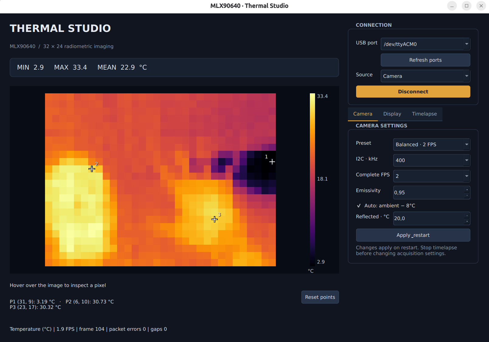
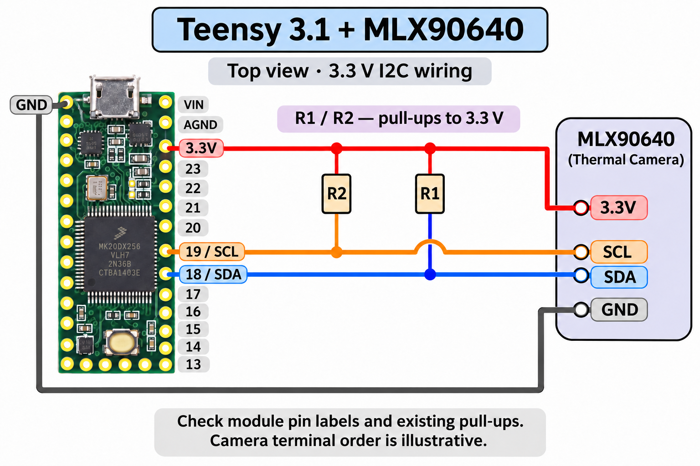

# Teensy Infrared Thermal Camera with MLX90640

A thermal camera project based on a Teensy 3.1 and an MLX90640 sensor.
The design connects sensor acquisition over I2C to a Python desktop viewer over USB,
with live display, image adjustments, video recording, and timelapse as project goals.



The Python viewer displays 32 × 24 object temperatures in °C using each sensor's
EEPROM calibration and per-subpage auxiliary measurements. The Teensy acquires
and sends raw subpages over USB. Python selects the I2C clock and sensor refresh
rate before acquisition. The Qt desktop app adds configuration controls,
timelapse recording, and MP4 export. The connected setup
measures approximately 1.97 complete FPS at the default 400 kHz / 2 FPS settings.

## Teensy development in VS Code

The project uses [PlatformIO IDE](https://platformio.org/install/ide?install=vscode)
inside VS Code with the Arduino framework. PlatformIO manages the Teensy platform,
compiler, framework, and upload tool; a separate Arduino IDE/Teensyduino installation
is not required for this workflow. The board ID is
[`teensy31`](https://docs.platformio.org/en/latest/boards/teensy/teensy31.html)
(Teensy 3.1 / 3.2). `platformio.ini` selects USB Serial and includes only the root
sketch in the build, excluding the legacy MSP430 examples.

### Install and build

1. Open this repository folder in VS Code.
2. Open Extensions (`Ctrl+Shift+X`), search for **PlatformIO IDE** by PlatformIO,
   and install or enable it. Reload VS Code if prompted. No additional Arduino
   extension is necessary.
3. Open the PlatformIO sidebar and wait for initialization. The first build
   downloads the Teensy development packages and requires internet access.
4. Under **Project Tasks → teensy31 → General**, select **Build**. This step
   compiles without a connected board.

The equivalent commands in a **PlatformIO terminal** (PlatformIO menu: New Terminal)
are:

```bash
pio run -e teensy31
pio device list
pio run -e teensy31 -t upload
```

If `pio` is unavailable in a regular Linux terminal, use the installed executable:

```bash
~/.platformio/penv/bin/pio run -e teensy31
```

### Linux USB permissions

Install the [official PJRC udev rules](https://www.pjrc.com/teensy/td_download.html)
once. These rules cover Teensy USB access, including the programming interface;
serial-port permissions alone do not cover uploading.

Run in a Linux terminal:

```bash
curl --fail --location https://www.pjrc.com/teensy/00-teensy.rules -o /tmp/00-teensy.rules
# Optional: inspect the downloaded rules before installing them.
cat /tmp/00-teensy.rules
sudo install -m 0644 /tmp/00-teensy.rules /etc/udev/rules.d/00-teensy.rules
sudo udevadm control --reload-rules
sudo udevadm trigger
```

Unplug and reconnect the Teensy after installing the rules. These commands require
administrator access for the system rules; compilation and uploading run as your
normal user.

### Connect and upload

1. Connect the Teensy with a data-capable USB cable.
2. Close the Python viewer and any serial monitor that holds the USB port.
3. Select **Project Tasks → teensy31 → General → Upload**, or run the upload
   command above. The configured uploader is `teensy-cli`.
4. If the uploader waits for the board or automatic reboot does not work, press
   the Teensy's physical **Program** button once while the uploader waits.
5. Use `pio device list` or `python -m thermal_viewer --list-ports` to find the
   USB serial port after the sketch starts.

The Program button enters the USB bootloader; programming mode does not require
a visible COM port. The current firmware sends binary packets, not terminal text.
Use the Python viewer rather than a serial monitor to display its simulated images.

An alternative workflow uses Arduino IDE 2 with the Teensy package installed
through Boards Manager, following [PJRC's instructions](https://www.pjrc.com/teensy/td_download.html).
For this repository, PlatformIO keeps the build configuration in the project.

## Run the Python viewer

See the [thermal_viewer package guide](thermal_viewer/README.md) for the role of
every source file, data flow, recording format, and developer commands.

Run these commands from the repository root with Python 3.10 or newer:

```bash
python3 -m venv .venv
source .venv/bin/activate
python -m pip install -r requirements.txt
python -m thermal_viewer --demo
```

On Windows, use `py -m venv .venv` and `.venv\Scripts\activate` instead.
The viewer requires a graphical desktop. Qt (PySide6 Essentials) provides the
interface; Matplotlib supplies color palettes only.

Open the desktop app, or select a USB device from the terminal:

```bash
python -m thermal_viewer
python -m thermal_viewer --list-ports
python -m thermal_viewer --port /dev/ttyACM0
# Windows example:
python -m thermal_viewer --port COM3
```

The image appears on the left with a color scale and minimum/maximum/mean values.
The sidebar has **Camera**, **Display**, and **Timelapse** tabs. Choose a port and
source, then click **Connect**. `--port` connects automatically; `--demo` starts
host-only synthetic data without hardware.

Camera presets are **Balanced** (400 kHz / 2 FPS), **Robust cable** (100 kHz /
1 FPS), and **Slow** (100 kHz / 0.5 FPS). Edit the settings and click **Apply &
restart** to stop the worker and start a new confirmed configuration. This also
applies emissivity/reflected-temperature changes. Palette and automatic/fixed
range are display-only controls. The normal camera scale is °C; test sources show
synthetic counts. No sensor settings are written while acquisition is running.

Close the app or click Disconnect to stop acquisition. USB errors stay visible
in the status area and terminal. Only one viewer or serial monitor uses a port at
a time. A latched camera fault still requires the recovery described below;
the interface does not automatically reset or retry sensor configuration.

Camera readouts use °C; demo/test-pattern readouts use synthetic counts. Masked
pixels show `unavailable`. Selections stay on the same sensor cells when resizing
the window and clear when reconnecting/restarting the source. Probes use the
received image in memory and make no additional I2C requests. Crosses/readouts are
desktop overlays; the timelapse retains its existing image and measurement format.

## Timelapse

1. Connect a source and wait for the first image.
2. Open **Timelapse**, choose an output folder and capture interval (default 10 s).
3. Click **Start timelapse**, then **Stop timelapse** when finished.
4. After queued frames finish saving, choose playback FPS (default 24) and click
   **Export MP4**. The video appears in the recording folder.

The capture interval and playback FPS are independent. For example, one image
every 10 seconds played at 24 FPS gives 240× time compression. Only new complete
images are selected; a low-rate camera does not produce duplicate frames to fill
the interval. The app reports skipped intervals and stops recording on source
failure/disconnection. Acquisition and disk writing run separately with a bounded
queue. Camera/display settings stay locked during recording to keep the session
consistent; stop recording before applying changes.

Each recording creates a new folder under `captures/` by default:

- `frames/*.png`: colored images with timestamps, units, and display range.
- `data/*.npz`: 24 × 32 values in °C (synthetic counts in test modes) and both
  original USB subpage payloads for real camera frames.
- `session.json`: source, EEPROM, calibration assumptions, acquisition and display settings.
- `frames.jsonl` and `summary.json`: actual timing, saved frames, skips, and errors.
- `timelapse-24fps.mp4`: exported video; existing videos are not overwritten.

Use a fixed display range for comparable colors across a timelapse. Automatic
range saves its actual limits per image. Demo/test-pattern sessions are explicitly
marked as synthetic and have no real subpages. Closing the app drains pending
writes before exit. Captures are excluded from Git.

## Wiring



| MLX90640 signal | Teensy 3.1 connection |
| --- | --- |
| SDA | Pin 18 (SDA0) |
| SCL | Pin 19 (SCL0) |
| GND | Common ground |

⚠️ **Warning:** do not forget to add pull-up resistors on the I2C SDA and SCL pins.

The sensor uses the main `Wire` bus. See the [PJRC pinout](https://www.pjrc.com/teensy/card5b_rev3.pdf).
The computer connects through the Teensy's USB connector. Module power wiring
and existing I2C pull-up resistors require confirmation against the actual module.


## USB connection

The selected transport is USB CDC, a virtual serial port accessed through Teensy
`Serial` and Python `pyserial`. The proposed binary protocol carries commands,
calibration, and raw subpages with framing and a checksum. USB Serial operates at
USB speed rather than a UART baud rate; see [PJRC's USB Serial documentation](https://www.pjrc.com/teensy/td_serial.html).

## Technical documentation

- [Architecture and protocol proposal](docs/architecture.md): responsibilities,
  packet layouts, acquisition constraints, error handling, and validation work.
- [Agent instructions](AGENTS.md): repository conventions and hardware constraints.
- [MLX90640 datasheet](docs/MLX90640-Datasheet-Melexis.pdf).
